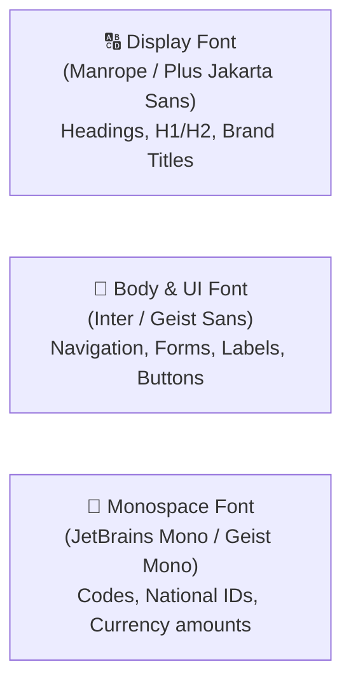
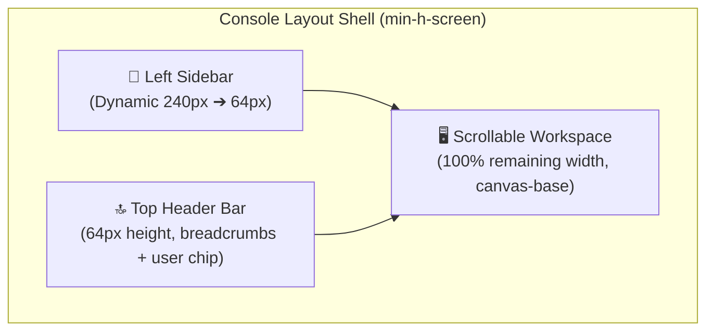

# Design System Specification: [Theme Name / Visual Identity]

> 🎨 Master UI/UX Design System Specification · Living Visual Standard  
> 🔄 Last Updated: [YYYY-MM-DD] · Status: [Draft / Approved / In Production]  
> 👤 Design Authority: [Lead Designer / Frontend Architect]  
> 📂 Repository Location: `DESIGN.md` (root) or `docs/architecture/design-system.md`  
> ⚠️ **MANDATORY QUALITY GATE (Hard Gate 17 — Anti-Generic UI Mandate)**: Frontend applications MUST NOT look like unstyled generic Bootstrap templates or default flat-white component dumps. Every user-facing system must define a deliberate visual identity, dual-mode color tokens, the "No-Line" spatial layout rule, a typographic triad, and rich micro-interaction states.

---

## 1. Aesthetic Philosophy & Visual Identity

### 1.1 Design Persona & Theme Narrative
- **Theme Name**: [e.g. Institutional Authority, FinTech High-Density, Clean Minimalist Saas]
- **Design Persona**: [e.g. The Institution — Authoritative, deliberate, secure, and modern; designed for enterprise governance and institutional trust.]
- **Anti-Generic Directives**:
  - **No Plain White/Black Extremes**: Avoid blinding pure `#FFFFFF` backgrounds or harsh `#000000` borders. Use nuanced tinted canvases and subtle tonal shifts.
  - **No Cookie-Cutter Blue**: Avoid generic primary blues (`#0000FF` or default browser blue). Use deep corporate navies, slate-tinted indigos, or brand-specific refined gradients.
  - **Elevation Over Outlines**: Separate content using background tint contrast and diffuse shadows rather than dense black borders.

### 1.2 Prohibited AI Design Clichés & UI Slop (Strictly Forbidden)
Any frontend implementation displaying the following hallmarks of lazy AI generation SHALL be automatically rejected:
1. **The "Fake Security / Buzzword Pill" Cliché**: Floating pill badges with meaningless text (e.g. "CONTROL PERIMETRAL SEGURO", "ENTERPRISE READY", "CUMPLIMIENTO DGII & NIIF") placed as screen ornaments. Badges must only convey actual dynamic system state.
2. **The "Redundant Input Icon" Cliché**: Placing an envelope icon inside an email field, a lock icon inside a password field, or a user icon inside a name field. Input fields must rely on clean typography and overline labels, not decorative icon clutter.
3. **The "Demo Credentials Box" Cliché**: Exposing test/admin credentials in a callout box on the login screen ("Credenciales de prueba: admin@..."). Real software never exhibits demo credentials on production interfaces.
4. **The "Centered Floating Card in a Blank Void" Cliché**: Centering a tiny white bordered box in the middle of a massive blank canvas. Authentication screens must use purposeful structural layouts, such as the **Split-Screen 50/50 Layout** (solid brand panel on the left with typography and product narrative, clean form on the right).
5. **The "Border-Obsession" Anti-Pattern**: Drawing 1px dark borders around cards, headers, footers, and inserting `<hr />` dividing lines between sections. Spatial hierarchy must follow the **No-Line Rule** (tonal background shifts and diffuse shadows).
6. **The "OS Dark Mode Desync" Anti-Pattern**: Blindly applying uncoordinated Tailwind `dark:` classes that follow OS preferences, resulting in black inputs on white cards. Dark mode MUST be controlled by an explicit `.dark` class toggle with synchronized tokens.
7. **The "Flat Button" Anti-Pattern**: Using generic solid blue/black buttons without the brand's specified gradient, hover micro-interactions, or active state scaling (`active:scale-[0.98]`).
8. **The "Layout Drift / Fragmented Flow" Anti-Pattern**: Implementing a tailored layout (such as the split-screen shell) for the entry page (`/login`), but reverting sibling pages in the same flow (`/recuperar-contrasena`, `/restablecer-contrasena`, `/verificar-2fa`) to generic centered cards or injecting redundant global headers/footers. Sibling routes in any flow MUST inherit a single shared layout shell (`(auth)/layout.tsx` or `<AuthShell>`).

---

## 2. Semantic Dual-Mode Token System

| Token Name | Light Mode (Default) | Dark Mode | Role / Semantic Purpose |
| :--- | :--- | :--- | :--- |
| **`canvas-base`** | `#[hex]` (e.g. `#F9F9FF`) | `#[hex]` (e.g. `#111319`) | Global app background, viewport canvas |
| **`surface-card`** | `#[hex]` (e.g. `#FFFFFF`) | `#[hex]` (e.g. `#1E1F25`) | Form containers, modal dialogs, elevated cards |
| **`surface-inset`** | `#[hex]` (e.g. `#F2F3FF`) | `#[hex]` (e.g. `#1A1B21`) | Sidebar background, table header tint, filter trays |
| **`text-primary`** | `#[hex]` (e.g. `#1B2A4A`) | `#[hex]` (e.g. `#E2E2EA`) | Headings, main metric numbers, table primary text |
| **`text-secondary`** | `#[hex]` (e.g. `#505F76`) | `#[hex]` (e.g. `#C4C6D4`) | Subtitles, labels, breadcrumbs, muted metadata |
| **`accent-primary`** | Gradient `135° #[hex] ➔ #[hex]` | Gradient `#[hex] ➔ #[hex]` | Primary CTA buttons, active state indicators |
| **`ghost-border`** | `rgba([r],[g],[b], 0.08)` / `#CBD5E1` | `rgba(255,255,255, 0.05)` | Subtle structural demarcation (8-10% opacity) |

### 2.1 Status Badges & Semantic Feedback Pills

| State / Badge | Background (Light) | Text Color (Light) | Dark Mode Equivalent | Dot Indicator |
| :--- | :--- | :--- | :--- | :--- |
| **Active / Success** | `bg-emerald-50` (`#DCFCE7`) | `text-emerald-700` (`#166534`) | `bg-emerald-950/40 text-emerald-400` | Emerald pulse dot |
| **Warning / In-Review** | `bg-amber-50` (`#FEF3C7`) | `text-amber-800` (`#92400E`) | `bg-amber-950/40 text-amber-300` | Solid amber dot |
| **Danger / Terminated** | `bg-rose-50` (`#FFDAD6`) | `text-rose-800` (`#93000A`) | `bg-rose-950/40 text-rose-300` | Solid rose dot |
| **Neutral / Draft** | `bg-slate-100` (`#F1F5F9`) | `text-slate-700` (`#334155`) | `bg-slate-800 text-slate-300` | Slate dot |

---

## 3. Spatial Hierarchy & The "No-Line" Layout Rule

1. **Background Contrast Over Borders**:
   - Primary content areas, sidebars, and filter trays MUST NOT be separated by heavy `1px solid black` or dark gray border lines.
   - Spatial differentiation is achieved via background tonal shifts (`surface-inset` `#F2F3FF` adjacent to `canvas-base` `#F9F9FF` and elevated `surface-card` `#FFFFFF`).
2. **Ghost Borders**:
   - Thin borders with `8% - 10%` opacity (`rgba(27, 42, 74, 0.08)` in light mode, `rgba(255, 255, 255, 0.05)` in dark mode) are used strictly where required for accessibility and contrast ratios (WCAG AA).
3. **Elevation & Diffuse Shadows**:
   - Soft, multi-layered diffuse shadows: `shadow-sm shadow-slate-900/5` or `0 1px 3px rgba(0,0,0,0.05), 0 10px 15px -5px rgba(0,0,0,0.02)`.
   - Modals and floating popovers use `shadow-xl shadow-slate-900/10` with backdrop blur (`backdrop-blur-sm`).

---

## 4. Typographic Triad

A professional enterprise application MUST employ three distinct typographic roles:



### 4.1 Typography Scale & Rules
- **Display Font (`font-display`)**:
  - Purpose: Page titles, marketing banners, high-impact modal headers.
  - Scale: H1 (28px - 32px, bold 700/800, tracking -0.02em), H2 (22px - 24px, bold 700, tracking -0.015em).
- **Body / UI Font (`font-sans`)**:
  - Purpose: Form labels, table cell descriptions, button text, tooltips.
  - Scale: Body Base (14px - 15px, regular 400), Label MD (13px, medium 500), Micro-Badge (11px, uppercase, tracking +0.08em).
- **Monospace Font (`font-mono`)**:
  - Purpose: Entity codes (`ACT-2026-0001`), tax IDs (`001-XXXXXXX-X`), serial numbers, financial balances (`RD$ 125,000.00`).
  - Alignment Rule: **All numeric, financial, and currency amounts in tables MUST be right-aligned (`text-right`) and rendered in monospace.**

---

## 5. Layout Shell Architecture (The Console Layout)



### 5.1 Left Sidebar Specifications
- **Width Transitions**: Transitions smoothly from **240px (expanded)** to **64px (collapsed)** using CSS `transition: width 300ms cubic-bezier(0.4, 0, 0.2, 1)`.
- **Collapse Toggle Button**: Circular icon button (24px x 24px, 12px radius, white background, shadow elevation) positioned absolutely on the right border edge of the sidebar (`right-[-12px] top-[20px] z-20`). Toggles between `chevron-left` and `chevron-right`.
- **Navigation Item States**:
  - *Inactive*: Text Secondary color, transparent background.
  - *Hover*: Micro-translation `translateX(+2px)` with subtle background tint `rgba(27, 42, 74, 0.04)`.
  - *Active*: Accent text color, weight 600, with a **4px vertical active indicator bar** (`h-6 w-1 rounded-r-full`) positioned on the absolute left edge.
  - *Collapsed State*: Label text and right badges are hidden (`hidden`); centered 20px icons and active indicator bar remain fully visible.
- **Bottom User Profile Card**:
  - Fixed at the bottom of the sidebar. Displays circular avatar (36px), user name, role badge, and popover preferences trigger.

### 5.2 Top Header Bar Specifications
- **Height**: Exactly `64px`, with subtle bottom ghost border (`border-b border-slate-200/80`).
- **Left**: Dynamic breadcrumbs hierarchy (`Inter 12px`, e.g. `Inicio / Activos / Ficha Técnica`).
- **Center**: Quick-search spotlight trigger (`Cmd + K` / `Ctrl + K`).
- **Right**: Role simulator dropdown (for previewing role experiences live) and notification bell with count badge.

### 5.3 Unified Authentication Shell (Split-Screen 50/50 Layout)
Instead of individual pages inventing their own layout or centering cards in a blank void, all public authentication and access routes MUST share a single, unified layout shell (e.g. `app/(auth)/layout.tsx` or a reusable `<AuthShell>` component).

Leaf pages (`/login`, `/recuperar-contrasena`, `/restablecer-contrasena`, `/verificar-2fa`) MUST ONLY render the inner form workspace (`children`) into the right panel. They MUST NOT declare their own outer wrappers, headers, footers, or background canvases.

#### Shell Architecture:
- **Left Panel (Brand Authority, 50% Desktop Viewport)**:
  - Container: Fixed full height (`100vh`), sticky/non-scrolling, solid deep brand color (e.g. Navy `#002B49`), flex column justify-between p-12.
  - Brand Mark: Primary institutional logo or SVG brandmark (white/light monochrome).
  - Typography: Product brand title in Display font (Manrope 800, 32px), single concise mission statement (Inter 15px, text-slate-300), and institutional attribution footer in Monospace font (JetBrains Mono 11px, text-slate-400).
  - Anti-Slop Directive: NO decorative buzzword badges, NO abstract vector illustrations, and NO random gradients.
- **Right Panel (Form Workspace, 50% Desktop Viewport)**:
  - Container: `canvas-base` (`#F9F9FF`), full height (`100vh`), scrollable if needed, centered flex column (`max-w-md mx-auto w-full px-8 py-12`).
  - Structure: Left-aligned clean form layout (NOT trapped in a small bordered card box).
  - Standard Typography:
    - Flow Heading: Manrope 26px bold (`text-slate-900`).
    - Flow Subtitle: Inter 14px (`text-slate-500 mt-1 mb-8`).
    - Form Field Labels: 11px uppercase overline (`tracking-wider text-slate-500 font-semibold mb-2 block`).
  - Standard Input Controls:
    - Dimensions: Height `48px`, border radius `12px` (`rounded-xl`).
    - Surface: `surface-inset` background (`#F2F3FF`), ghost border (`border border-slate-200/60`).
    - Focus State: Crisp 2px accent ring (`focus:ring-2 focus:ring-blue-600 focus:bg-white focus:outline-none`).
  - Action Buttons:
    - Primary Submit: Full-width brand gradient button (height `48px`, font-medium, rounded-xl, `active:scale-[0.98] transition-all`).
    - Secondary Nav / Back Link: Clean text button or subtle link (`text-sm font-medium text-slate-600 hover:text-slate-900 transition-colors`).
  - Notifications & Error Display: Single clean banner with soft rose background (`bg-rose-50 text-rose-800 border border-rose-200 text-sm rounded-lg p-3.5`), without redundant warning icons.
- **Responsive Mobile View**:
  - The left brand panel collapses into a compact top branded banner (height ~80px, displaying logo and product name), and the form workspace takes 100% viewport width below.

#### Flow Route Uniformity Matrix:
| Route | View Heading | Primary Action | Secondary Navigation | Replaces Form In-Place? |
|---|---|---|---|---|
| `/login` | Iniciar sesión | Entrar al Sistema | ¿Olvidaste tu contraseña? | No |
| `/recuperar-contrasena` | Recuperar acceso | Enviar enlace de restablecimiento | ← Volver al inicio de sesión | Sí (Paso 2 confirmación neutra) |
| `/restablecer-contrasena` | Restablecer contraseña | Guardar nueva contraseña | ← Volver al inicio de sesión | No (Redirige a `/login` al éxito) |
| `/verificar-2fa` | Verificación de identidad | Confirmar código | Probar otro método / Cancelar | No |

---

## 6. Component Specifications

### 6.1 KPI Summary Cards
- Container: `surface-card` background, `ghost-border`, `shadow-sm shadow-slate-900/5`, `p-5 rounded-xl`.
- Layout: Icon container (40px x 40px rounded-lg with soft brand tint) top-right, label (Inter 13px text-secondary) top-left, big metric value (Display/Mono 24px bold) bottom-left, percentage change badge bottom-right.
- Hover Effect: Subtle border highlight transition `border-slate-300` on hover.

### 6.2 Data Tables
- Header: `surface-inset` background, uppercase 11px Inter labels with `tracking-wider`, `text-slate-500`.
- Rows: Alternating or clean rows with hover highlight `hover:bg-slate-50/80`.
- Cells: Vertical alignment center, standard padding `py-3.5 px-4`.
- Numeric / Financial Columns: Strictly right-aligned (`text-right font-mono text-sm`).
- Sticky Pagination Footer: Fixed at the bottom of the table viewport with total count, page size selector, and previous/next page buttons.

### 6.3 Action Buttons
- **Primary CTA**: Brand accent gradient (`bg-gradient-to-r from-blue-700 to-indigo-600 hover:from-blue-800 hover:to-indigo-700 text-white font-medium rounded-lg px-4 py-2 shadow-sm transition-all active:scale-[0.98]`).
- **Secondary / Ghost**: Ghost border `border border-slate-200 hover:bg-slate-50 text-slate-700 rounded-lg px-4 py-2`.
- **Destructive**: Rose tint `bg-rose-50 text-rose-700 hover:bg-rose-100 border border-rose-200`.

---

## 7. Tailwind CSS Configuration Blueprint (`tailwind.config.ts`)

```typescript
import type { Config } from "tailwindcss";

const config: Config = {
  darkMode: ["class"],
  content: [
    "./pages/**/*.{ts,tsx}",
    "./components/**/*.{ts,tsx}",
    "./app/**/*.{ts,tsx}",
    "./src/**/*.{ts,tsx}",
  ],
  theme: {
    extend: {
      colors: {
        canvas: {
          base: "var(--canvas-base)",
        },
        surface: {
          card: "var(--surface-card)",
          inset: "var(--surface-inset)",
        },
        brand: {
          primary: "var(--brand-primary)",
          navy: "#002B49",
          crimson: "#990000",
        },
        text: {
          primary: "var(--text-primary)",
          secondary: "var(--text-secondary)",
        },
      },
      fontFamily: {
        display: ["var(--font-display)", "sans-serif"],
        sans: ["var(--font-sans)", "sans-serif"],
        mono: ["var(--font-mono)", "monospace"],
      },
      borderRadius: {
        lg: "var(--radius)",
        md: "calc(var(--radius) - 2px)",
        sm: "calc(var(--radius) - 4px)",
      },
      boxShadow: {
        subtle: "0 1px 3px rgba(0,0,0,0.04), 0 1px 2px rgba(0,0,0,0.02)",
      },
    },
  },
  plugins: [require("tailwindcss-animate")],
};

export default config;
```

---

## 8. Verification & Compliance Checklist (Gate 17)

Before approving any UI task or front-end pull request, verify:
- [ ] No raw `#000000` or harsh 1px borders used as layout separators.
- [ ] Dual-mode support verified: all components render cleanly in both Light and Dark mode.
- [ ] Typographic triad applied: headings use Display font, UI uses Sans, monetary amounts and codes use Monospace.
- [ ] Financial and code amounts in tables are right-aligned.
- [ ] Status pills use soft tinted containers (`bg-*-50 text-*-700 border-*-200`), not saturated solid primaries.
- [ ] Sidebar collapses smoothly (240px ➔ 64px) with icon centering and left indicator bars.
- [ ] Interactive elements have active/hover feedback states (`active:scale-[0.98]`, hover micro-translations).
